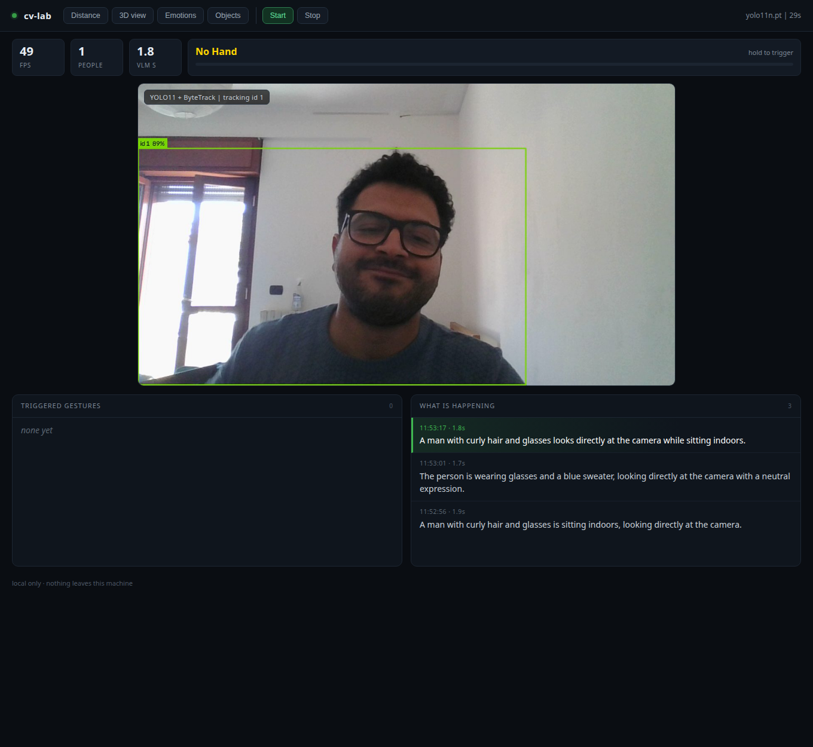

# cv-lab

Local computer vision on one laptop GPU. A webcam feed with person tracking, hand
gestures, facial expression, metric distance and a live 3D point cloud, plus a
vision-language model that describes what is happening. Every frame stays on the
machine.

**Status:** working prototype, used daily on my own desk. Not published as a
package yet.



## What it does

- **Person tracking** with stable ids (YOLO11n + ByteTrack), about 60 fps
- **Hand landmarks** (21 points per hand) and **held-gesture** recognition
- **Facial expression** scoring from 52 blendshapes, on CPU
- **Metric distance**: click any pixel, get metres
- **Live 3D point cloud**, orbit with the mouse
- **Scene narration** from a local vision model, only when the frame changes
- **Object detection** across 80 COCO classes, on demand

Everything is exposed on one page at `127.0.0.1:8099`, and every capability is a
toggle in the header.

## How it works

One capture thread owns the camera. It runs tracking and draws boxes, keeps an
overlay-free copy of every third frame, and publishes the annotated JPEG to an
MJPEG stream. Hand and face models read the same frames on a downscale. A depth
worker reads the clean copy only when distance or 3D is enabled. A narration worker
watches for pixel change and asks the local model for one sentence.

Depth and narration share one GPU, so they never run at the same time.

A full architecture diagram and a function-by-function reference are in
[docs/cv-lab-architecture.pdf](docs/cv-lab-architecture.pdf).

## Requirements

- Linux with a V4L2 camera (`/dev/video0`)
- NVIDIA GPU with 6 GB or more (developed on an 8 GB laptop 4060)
- Python 3.12 or newer
- Ollama with a vision model, only for narration (`ollama pull qwen2.5vl:3b`)

The camera is exclusive. Nothing else can hold it while this runs.

## Install

```bash
git clone <your-fork-url> cv-lab && cd cv-lab
bash fetch-models.sh     # hand + face landmarkers, YOLO weights
bash setup.sh            # venv, torch, ultralytics, opencv
```

Model weights are not in the repository. `fetch-models.sh` pulls the three files
from their upstream releases.

## Run

```bash
./svc.sh start        # systemd --user service, http://127.0.0.1:8099
./svc.sh status
./svc.sh stop
```

Without systemd:

```bash
source .venv/bin/activate
python webui.py --port 8099
```

## Controls

| Control | What it does |
|---|---|
| Start / Stop | Opens and closes the camera. Stop releases the device. |
| Distance | Metric depth; click the video to measure |
| 3D view | Replaces the video with an orbitable point cloud |
| Emotions | Expression scores and a face box |
| Objects | Detects all 80 COCO classes, not just people |

## Performance

Measured on an RTX 4060 Laptop at 1280x720:

| Stage | Cost |
|---|---|
| Detection and tracking | 5-6 ms per frame |
| Hand landmarks (0.6 scale, every other frame) | 10-15 ms |
| Expression | ~10 ms, CPU |
| Metric depth | ~300 ms per pass |
| Narration | 1.6-1.9 s |
| End to end, hands on | ~40 fps |
| End to end, tracking only | ~60 fps |

## HTTP interface

| Endpoint | Returns |
|---|---|
| `GET /` | Dashboard |
| `GET /stream` | MJPEG stream |
| `GET /snapshot` | Single annotated JPEG |
| `GET /events` | Stats, feeds, gesture, expression, objects |
| `GET /measure?x=&y=` | Distance in metres at normalised coordinates |
| `GET /depthmap` | Depth heatmap |
| `GET /pointcloud` | Binary float32 x,y,z,r,g,b |
| `POST /api/toggle` | Enable or disable depth, cloud, emotion, objects |
| `POST /api/run` | Start or stop capture |

## What it gets wrong

Real limits, not disclaimers.

- **Glass.** Monocular depth has no cue for a transparent pane. It reports the
  surface behind it, or invents one. Walls and furniture are usable; windows are not.
- **Expression is not mood.** The model reads the face. Glasses, beards and poor
  light all reduce accuracy.
- **The 3D view is a sketch.** No loop closure, no drift correction. Accurate
  mapping needs a depth sensor and a SLAM stack.
- **Categories, not instances.** It knows "bottle", not "my bottle". Your own
  objects need a trained model.

## Roadmap

Planned, not implemented. Listed so the direction is clear, not to claim it works.

- Record clips from the dashboard
- A custom detector trained on my own classes
- Sensor inputs: ultrasonics, microphone, audio output
- A robot control layer on top of the distance and tracking streams

## Layout

| Path | Purpose |
|---|---|
| `webui.py` | HTTP server, capture loop, workers, page |
| `gesture.py` | Hand landmarks, finger states, hold timer |
| `emotion.py` | Blendshape to expression scores |
| `depth.py` | Metric depth, point cloud |
| `setup.sh` | Environment setup |
| `svc.sh` | Service control |
| `docs/` | Architecture PDF and screenshots |

## Notes from building it

Three things cost more time than the models did.

Python 3.14 has no wheels on the CUDA 12.6 index; plain PyPI resolves CUDA 13
correctly. Running the server from a shell job meant it died with the shell, so it
lives under systemd --user. Headless screenshots do not composite canvas content,
which makes a working 3D view look broken until you read the pixels back in the
page.

Also: the camera is exclusive, so a failed capture usually means another app
holds the device, and MediaPipe 1.x dropped the old solutions API, so the tasks
API is the only way in.

## Author

Oussama Boukhachem

- GitHub: https://github.com/oussama-boukhachem
- Site: https://oussama.digital

## License

MIT. See `LICENSE`.
